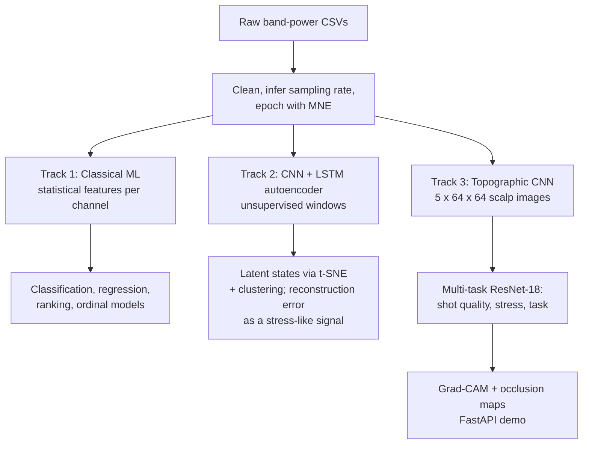

# EEG Analysis: Cognitive State and Performance in Airgun Shooting

**Can brain activity tell us whether a shot will be good, and how stressed the shooter is?** This project analyses 8-channel EEG recorded from airgun shooters during repeated shooting series. It combines classical machine learning on band-power features, an unsupervised autoencoder that discovers latent brain states, and a deep model that turns EEG into scalp images and explains its own predictions.


---

## The data

| Item | Detail |
| --- | --- |
| Signal | FFT band power over 5 bands (Delta, Theta, Alpha, Beta, Gamma) |
| Electrodes | 8 channels on the 10–20 system: F3, Fz, F4, C3, C4, Pz, O1, O2 |
| Sessions | Six recordings, two shooters × three series (`data/skytt{1,2}serie{1,2,3}.csv`), about 135,600 time steps in total |
| Derived | Per-channel statistical features (`combined_features.csv`), latent state summaries (`state_summary.csv`, `states_per_window.csv`) |

The sampling frequency is inferred from the timestamp column, then recordings are epoched with MNE for analysis.

## Three modelling tracks



### 1. Classical machine learning (`EEG Analysis.ipynb`)

Exploratory analysis of band activity across series, scalp topographies, then per-channel features (mean, standard deviation, range, median, skew, kurtosis) feeding scikit-learn pipelines:

- **Classification:** logistic regression, random forest, SVM
- **Regression:** ridge, random forest, SVR
- **Ranking and ordinal:** ridge, random forest and SVR rankers; ordinal classifiers

Fitted pipelines are saved in `models/` and predictions for the held-out series in `data/serie3_*.csv`.

### 2. Unsupervised brain states (`EEG_CNN_LSTM_Autoencoder.ipynb`)

A 1D-CNN + LSTM autoencoder learns from overlapping, unlabelled windows across all recordings. Its latent vectors are projected with t-SNE and clustered into discrete states; clusters with consistently higher reconstruction error are flagged as stress-like candidates for follow-up.

### 3. Explainable topographic CNN (`src/`, `app/`)

1. **Scalp images** (`src/data_processing.py`): each band's 8 electrode values are interpolated with cubic `griddata` onto a 64 × 64 head grid; stacking the 5 bands gives one 5-channel image per time step.
2. **Model** (`src/model.py`): an ImageNet-pretrained ResNet-18 whose first convolution is widened to 5 input channels (pretrained filters copied across), with three heads: shot quality (binary), stress (regression) and task (3 classes).
3. **Training** (`src/train.py`): leave-one-session-out cross-validation so every fold is tested on a recording the model never saw; augmentation is limited to small rotations and shifts, with no left–right flips because hemispheres are not interchangeable.
4. **Explanation** (`src/explain.py`): Grad-CAM and sliding-window occlusion maps show which scalp regions drove each head's prediction.
5. **Demo** (`app/main.py`): a FastAPI service with a browser page to sample an epoch, predict, and overlay the explanation map.

| Endpoint | Purpose |
| --- | --- |
| `GET /api/random_sample` | Pull a cached scalp image |
| `POST /api/predict` | Shot quality, stress and task predictions |
| `POST /api/explain` | Grad-CAM or occlusion heatmap for a chosen head |

## Getting started

```bash
git clone https://github.com/albertmwangwa/EEG-Analysis.git
cd EEG-Analysis
python -m venv .venv && source .venv/bin/activate     # Windows: .venv\Scripts\Activate.ps1
pip install -r requirements.txt
python verify_setup.py

# Notebooks
jupyter lab

# Deep pipeline: build scalp-image caches in EEG_Topographic_CNN.ipynb, then
python -m src.train
uvicorn app.main:app --reload       # open http://127.0.0.1:8000/static/index.html
```

## Status and honest limitations

This is a research prototype, and the results should be read with that in mind.

- **Labels in the deep pipeline are placeholders.** `src/train.py` currently generates random shot, stress and task labels to exercise the training loop end to end. Metrics from it are not meaningful until real per-epoch labels are joined in.
- **Small sample.** Two shooters and six recordings support exploration and method development, not general claims about shooters.
- **Stress is inferred, not measured.** The autoencoder's stress-like states are hypotheses to validate against a physiological or self-reported measure.

### Roadmap

- [ ] Join real shot scores and task labels to each epoch; report LOSO metrics per head
- [ ] Validate latent states against heart-rate or questionnaire stress measures
- [ ] Move generated images and caches out of git (Git LFS or a release asset)
- [ ] Pin the Python version and add a minimal test suite

## Project layout

```
EEG-Analysis/
├── EEG Analysis.ipynb               # EDA + classical ML
├── EEG_CNN_LSTM_Autoencoder.ipynb   # Unsupervised latent states
├── EEG_Topographic_CNN.ipynb        # Scalp images + CNN experiments
├── src/                             # Reusable pipeline: images, model, training, explanations
├── app/                             # FastAPI demo + static page
├── data/                            # Recordings, features, predictions
├── models/                          # Saved scikit-learn pipelines
└── images/                          # Generated scalp images per recording
```

## Author

**Albert William Mwangwa** · MSc Data Science, University of Dar es Salaam
[GitHub](https://github.com/albertmwangwa)
